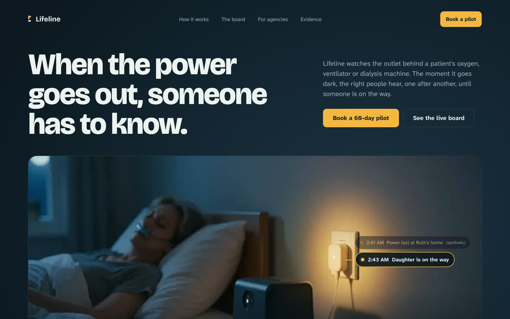
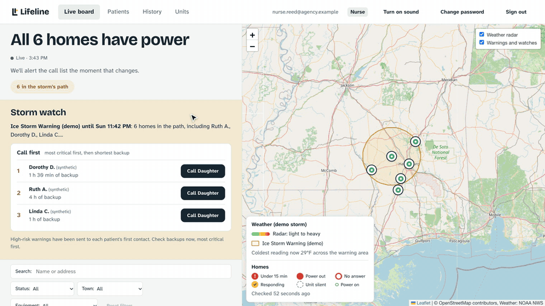
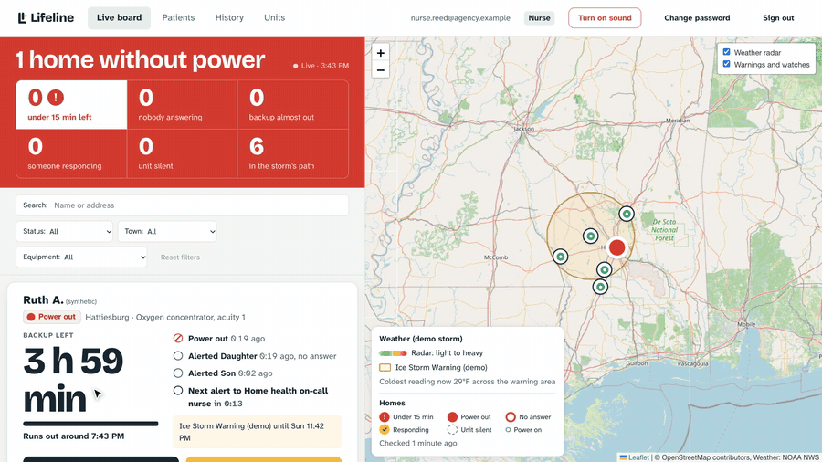
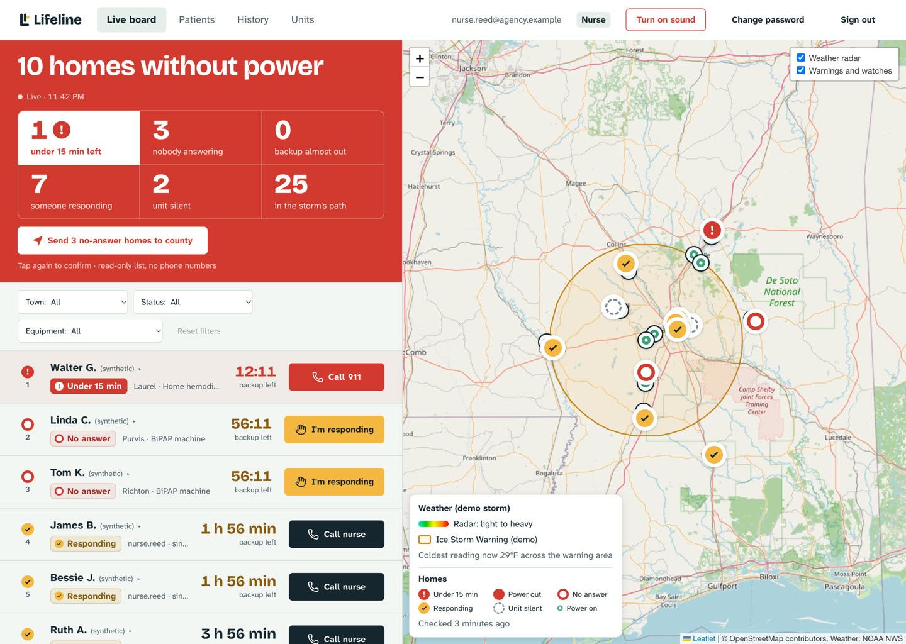
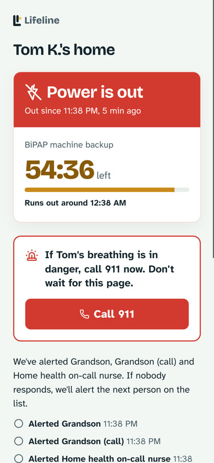
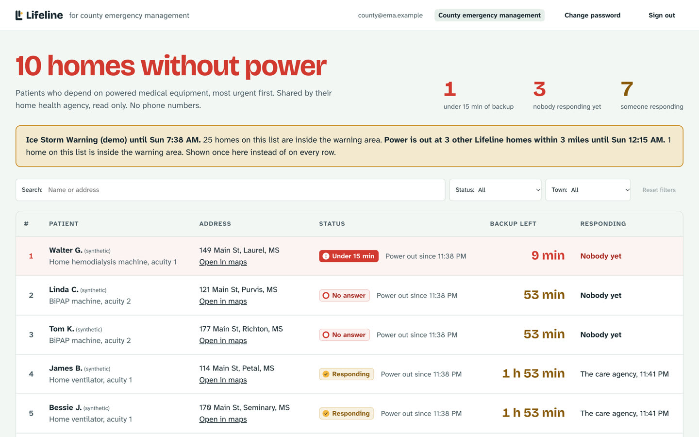
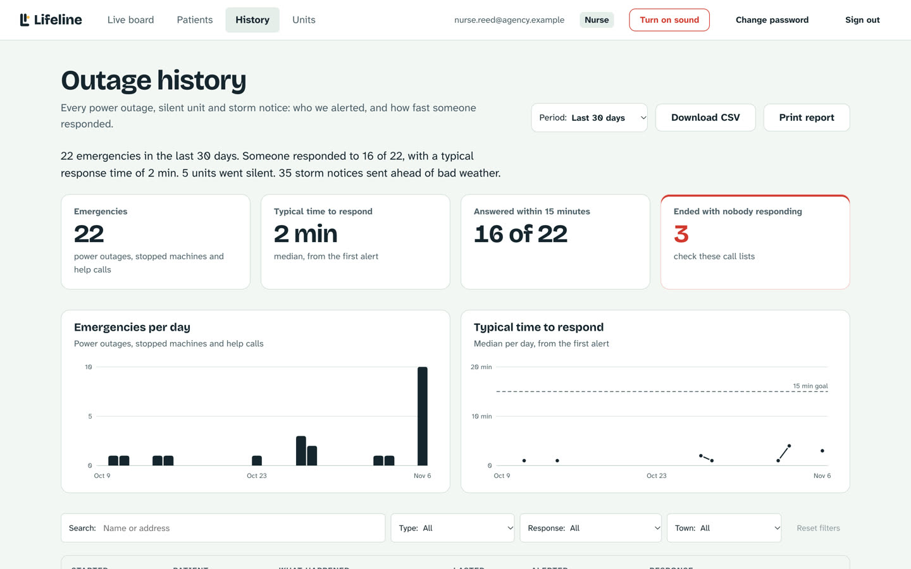
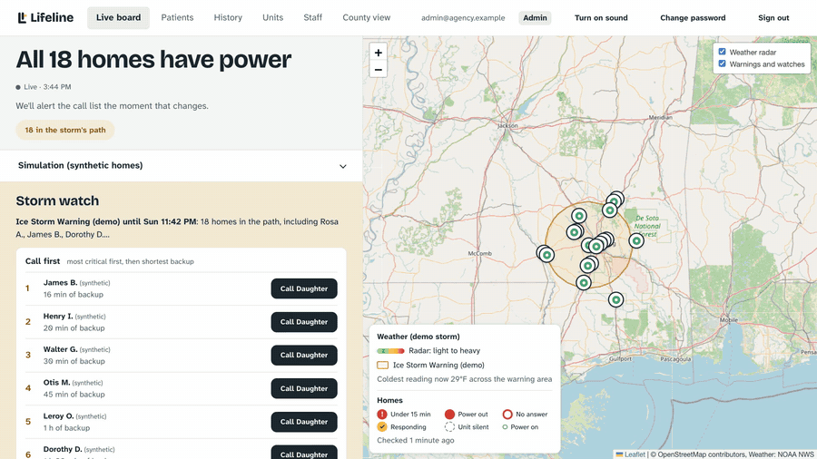
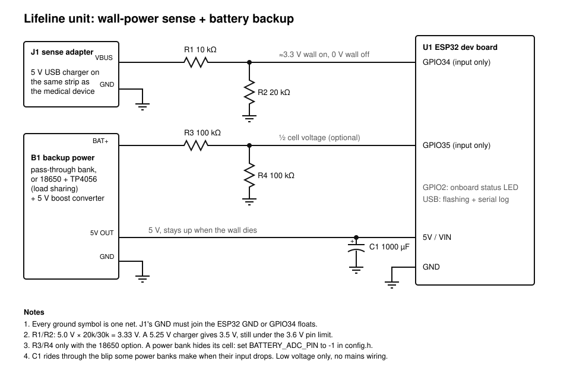

<p align="center">
  
</p>

<p align="center"><strong>When the power goes out, someone has to know.</strong></p>

<p align="center">
  Power-loss alerts for people at home on oxygen concentrators, ventilators and dialysis,
  built for the home health agencies that care for them.
</p>

<p align="center">
  
</p>

---

## The problem

Millions of people live on a wall socket. An oxygen concentrator, a home ventilator or a dialysis
machine stops the moment the power does, and with no power and no battery the machine's own alarm
doesn't sound. Nobody outside the house is told. Utilities can't promise when power comes back, and
outage maps show dark neighbourhoods, not patients.

Across the United States, 3,115,917 people on Medicare rely on electricity-dependent medical
equipment at home, and 380,319 of them also get home health care
([HHS emPOWER REST Service](https://empowerprogram.hhs.gov/empower-rest.html), November 2026 data,
state and territory counts summed). That count covers Medicare fee-for-service and Medicare
Advantage only, so people on Medicaid alone or private insurance are not in it.

Outages are getting longer. In 2024 U.S. electricity customers averaged 11 hours without power,
nearly twice the yearly average of the decade before, and major events such as hurricanes caused
80% of those hours
([U.S. Energy Information Administration](https://www.eia.gov/todayinenergy/detail.php?id=66744),
December 2025).

## What Lifeline does

A small unit plugs into the outlet beside the medical equipment. When wall power drops, it reports
within seconds. The server then alerts the patient's call list, one person after another, until
someone taps **I'm responding**, and the home health agency watches every patient on a live board.

<p align="center">
  
</p>

- **Escalating alerts.** Push, SMS or a voice call to contact 1; no answer in N minutes, contact 2,
  and so on. One tap on *I'm responding* stops the alerts for everyone and shows who is on the way.
- **A live board for the agency.** Every home ranked by how much backup is left, with the clock time
  it runs out, a map, and one-tap call, respond and directions.
- **A family page.** A private link in every alert shows that one patient's power, backup left and
  who is responding. No app, no sign-in.
- **15-minute emergency.** When a patient's backup is about to run out and nobody has responded, care
  staff and county emergency management get an emergency alert, with 911 one tap away.
- **Storm Watch.** National Weather Service warnings and forecast wind and ice over every home, and a
  "call first tonight" list of the patients with the least backup, before the power goes out.
- **County view.** Emergency management sees which homes are without power and how long their
  backup lasts, with no phone numbers, and receives welfare-check lists for homes nobody answered.
- **A record.** Every outage, alert and response time, exportable for the agency's emergency
  preparedness file.
- **Silence is an alert.** The unit checks in every 30 seconds; a unit that goes quiet is flagged.

<p align="center">
  
</p>

## Screens

| Live board during a storm | Family page |
|---|---|
|  |  |

| County view | History |
|---|---|
|  |  |

<p align="center">
  
</p>

All patients shown are synthetic.

## How it works

```
 wall outlet ──5 V USB adapter──▶ ESP32 unit (own battery, buzzer, button, OLED)
                                   │ power lost / restored, heartbeat every 30 s
                                   ▼ HTTPS over Wi-Fi (eduroam, home Wi-Fi or a phone hotspot)
                             Lifeline server (Python, one always-on process)
                                   ├─ escalation: contact 1 → no answer → contact 2 → …
                                   ├─ notifications: ntfy push, Twilio SMS and voice
                                   ├─ Storm Watch: National Weather Service API
                                   ├─ agency board and county view   (staff sign-in, roles)
                                   ├─ family status page /s/<link>  (no sign-in)
                                   └─ storage and staff accounts: Supabase (or local JSON files)
```

| Who | Where | What they can do |
|---|---|---|
| Power unit | `POST /api/report` with its own token | report wall power on or off |
| Family | `/s/<private link>` from the alert | see one patient's status; tap *I'm responding* |
| Admin | `/` | everything, including staff accounts and roles |
| Nurse | `/` | board, respond, patients and call lists |
| Viewer | `/` | board and history, no phone numbers |
| County emergency management | `/county` | homes without power and backup left; no phone numbers or links |

## Hardware

<p align="center">
  
</p>

| Part | Notes |
|---|---|
| ESP32 dev board | firmware builds for `esp32:esp32:esp32` |
| 5 V USB wall adapter | the wall-sense input, on the same outlet or strip as the medical equipment |
| 10 kΩ + 20 kΩ resistors | divider from the adapter's 5 V to GPIO34 (grounds shared) |
| Battery for the ESP32 | power bank with pass-through charging, or 18650 + TP4056 with load sharing |
| Optional | buzzer (GPIO25), push button (GPIO27), DHT11/22 room temperature (GPIO26), 128x64 I2C OLED (SDA 21, SCL 22), SCT-013 current clamp (GPIO32) |

Everything is low voltage; nothing touches mains wiring. Parts for one unit cost about $30 at retail.

## Firmware

```bash
cd firmware/lifeline
cp config.example.h config.h   # Wi-Fi networks, server URL, unit ID and token
arduino-cli lib install "Adafruit SSD1306" "Adafruit GFX Library" "DHT sensor library" "Adafruit Unified Sensor"
arduino-cli compile --fqbn esp32:esp32:esp32 .
arduino-cli upload  --fqbn esp32:esp32:esp32 -p /dev/cu.usbserial-XXXX .
```

- Lists any number of Wi-Fi networks in `config.h` (`WIFI_NETWORK(name, password, enterprise user)`)
  and tries each in turn; WPA2-Enterprise such as eduroam is supported.
- Talks HTTPS to the server and checks its certificate against the ESP32's built-in root list.
- Debounces 2 s of flicker, reports every change at once, retries with backoff until the server
  confirms, and sends a heartbeat every 30 s.
- Hold the button at power-on to open a setup page from a phone and change the network or server.
- The OLED shows power, outage time, Wi-Fi signal and whether the server confirmed the last report;
  the screen inverts during an outage.

## Run it locally

Python 3.10+, standard library only.

```bash
cd server
python3 test_domain.py                     # unit and integration tests
cp patients.example.json patients.json     # synthetic patients
LIFELINE_ADMIN_PASSWORD=pick-something-long ESCALATE_AFTER_SECONDS=20 python3 app.py
```

Open http://localhost:8080, sign in with any email and that password, then act as a unit:

```bash
R=localhost:8080/api/report; J='Content-Type: application/json'
curl -X POST $R -H "$J" -H 'X-Device-Token: change-me-unit-01' -d '{"device_id":"unit-01","wall_power":false,"battery_percent":94}'
```

Alerts print to the console unless a notifier is configured.

## Supabase

1. Create a Supabase project and run every file in `supabase/migrations/` in order in the SQL editor.
   Each table has row level security on with no policies, so only the server's secret key can read it.
2. Authentication → Sign In / Providers: turn off "Allow new users to sign up".
3. Create one user for yourself and set `LIFELINE_BOOTSTRAP_ADMIN` to that email. Add everyone else
   from the platform's **Staff** page, which creates the account with a temporary password and a role.
4. Put `SUPABASE_URL` and `SUPABASE_SECRET_KEY` in `server/.env` (see `server/.env.example`).

The secret key stays on the server; browsers only get an opaque, HttpOnly session cookie.

## Notifications

- **ntfy** (free push): `LIFELINE_NOTIFIER=ntfy` and a long random `NTFY_TOPIC`.
- **Twilio** (SMS and voice): `LIFELINE_NOTIFIER=twilio` with `TWILIO_ACCOUNT_SID`,
  `TWILIO_AUTH_TOKEN`, `TWILIO_FROM`, and the number's incoming-message webhook set to
  `https://<your host>/api/sms-inbound`. Replies are checked against Twilio's signature.

## Deploy

Lifeline must run as **one always-on process**: the escalation timers live in it. Two copies against
the same database would send every alert twice, and a host that sleeps stops escalation.

- **Azure App Service (Linux, B1)**: `server/deploy_azure.py package` builds an allowlisted zip (never
  `.env` or data files), `server/deploy_azure.py settings --public-url https://<host>` turns
  `server/.env` into app settings without printing them, and `server/startup.sh` restarts the app
  after a crash. Set Always On, one instance, and the health check path `/healthz`.
- **Fly.io**: `Dockerfile` and `fly.toml` (one machine, auto-stop off).
- **A VM behind Caddy**: `deploy/vm/` (systemd unit, setup and update scripts).

After deploying, `python3 server/smoke_test.py https://<host>` checks the health endpoint, pages,
security headers and that forged SMS replies are refused.

## Configuration

| Variable | Default | Meaning |
|---|---|---|
| `SUPABASE_URL`, `SUPABASE_SECRET_KEY` | (empty) | use Supabase for patients, incidents and staff sign-in |
| `LIFELINE_ADMIN_PASSWORD` | (empty) | local mode only: shared staff password |
| `LIFELINE_PUBLIC_URL` | `http://localhost:PORT` | base of family links in alerts |
| `PORT`, `LIFELINE_BIND` | 8080, 0.0.0.0 | where the server listens |
| `ESCALATE_AFTER_SECONDS` | 120 | wait before alerting the next contact |
| `OFFLINE_AFTER_SECONDS` | 90 | silence before a unit shows as offline |
| `LIFELINE_NOTIFIER` | console | `console`, `ntfy` or `twilio` |
| `LIFELINE_BOOTSTRAP_ADMIN` | (empty) | email that is always an admin |
| `LIFELINE_SESSION_SECRET`, `LIFELINE_RESPOND_SECRET` | random per start | sign sessions and one-tap respond links |
| `LIFELINE_COUNTY_CONTACT` | (empty) | `Name\|+1...\|sms` for county emergency management |
| `LIFELINE_STORM_WATCH` | on | `on`, `off` or `demo` |
| `LIFELINE_CLIENT_IP_HEADER` | (empty) | behind a proxy, the header holding the caller's address |
| `LIFELINE_STORM_SIM` | (empty) | `1` on a demo server only: admins can run a simulated storm on synthetic homes |
| `LIFELINE_DEMO_ASSUME_POWER` | (empty) | `1` on a demo server only: units that never reported show as powered |

## Project layout

| Path | What it holds |
|---|---|
| `server/domain.py` | patients, outages and escalation rules (no I/O) |
| `server/service.py` | use cases for units, families, staff and the county |
| `server/access.py`, `server/staff.py` | roles, permissions, sessions and sign-in throttling |
| `server/storm.py`, `server/weather.py` | Storm Watch rules and the National Weather Service adapter |
| `server/supabase_backend.py`, `server/local.py` | storage and sign-in adapters |
| `server/notifiers.py` | console, ntfy and Twilio delivery |
| `server/app.py` | HTTP routes, security headers, composition root |
| `server/static/` | landing page, board, county and family pages (vanilla JS, strict CSP) |
| `firmware/lifeline/` | ESP32 firmware |
| `supabase/migrations/` | database schema |
| `hardware/` | unit schematic |

## Privacy and safety

- Use synthetic data until you have a HIPAA-eligible setup and a business associate agreement with
  each vendor. Every patient in this repository and its screenshots is synthetic.
- Lifeline never powers, controls or connects to medical equipment; it watches the outlet and sends
  notifications. It adds to a patient's emergency plan and 911; it replaces neither.

## Status

Lifeline is a working prototype, not a certified medical product. Next: cellular connectivity so a unit works when home Wi-Fi goes down
too, and a pilot with a home health agency.

## License

[MIT](LICENSE). Lifeline is not a medical device and comes with no warranty; see the license.
